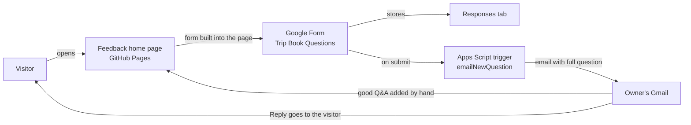

# Trip Book Questions & Feedback: how it is set up

Last updated: 2026-10-20

People read about the trip book, see common questions, and ask their own question on one web page. No account or sign-in is needed. New questions are emailed to the owner, who replies by email and adds good ones to the page.

## The three pieces

| Piece | Where it lives | What it does |
|---|---|---|
| **Feedback home page**<br>`feedback/feedback_home_page.html` | This repo, served by GitHub Pages:<br>https://xwueng.github.io/trip-book-builder/feedback/feedback_home_page.html | What a trip book is, the Common questions list, and the question form built into the page. |
| **Question form**<br>"Trip Book Questions" | Google Forms, in the owner's Google account.<br>Share link: https://forms.gle/jtDgiAySfNko1m4T9 | Collects each question. Stores all answers on its **Responses** tab. |
| **Email script**<br>`feedback_form.gs` | Google Apps Script at script.google.com, in the owner's Google account. A public copy, with the email removed, is at `feedback/feedback_form.gs`. | Created the form once. Its trigger emails each new question to the owner. |

## How a question flows



1. A visitor opens the feedback home page and opens **Ask a question or share feedback**.
2. They fill out the form inside the page and press **Submit**.
3. Google Forms saves the answer and shows the thank-you message inside the page.
4. The script's trigger runs and emails the full question to the owner. If the visitor left an email, pressing **Reply** goes straight to them.
5. The owner replies, and adds the question to **Common questions** on the page if others would find it useful.

## Feedback home page (`feedback/feedback_home_page.html`)

All feedback files live in the `feedback/` folder: the page, `feedback_form.gs`, and this document.

**Look:** same colors, fonts and cover box as `Student_Handbook.html`. The example Golden Gate page uses the trip book's own colors.

**Sections, top to bottom:** the cover ("What a trip book is"), the example page with four points and the Student Handbook link, **Common questions** (folds), and **Ask a question or share feedback** (folds). Both folding sections start closed.

**The built-in form:** the form is shown in a frame using its embed address:

```
https://docs.google.com/forms/d/e/1FAIpQLSclvDI4FXfRsSjBAqkiJhEaG3xfww00q5eqKb0-X9ed5BtpNg/viewform?embedded=true
```

A "Form not showing? Open it in a new tab" link under it uses the share link as a backup.

**Frame height:** a web page can't measure the inside of a Google Form, so the frame has fixed heights set in the page's CSS. The frame is 800px on computers and 1000px on phones, shrinking to 320px and 380px on the thank-you message. A small script counts loads inside the frame: the form, then thank-you, then the form again after "Submit another response." It shrinks the frame on every thank-you load. If a form question is added or removed, adjust these heights.

**If the form is ever replaced,** update both the embed address and the backup link in this file.

**If the page is ever moved or renamed,** update its address anywhere it is shared: the form's description and confirmation message (if they link to it), and any emails or guides that point to it.

### Adding a Common question

1. On GitHub, open the `feedback` folder, then `feedback_home_page.html`, and click the pencil icon.
2. Find the line `To add a question`.
3. Paste this right under it, then change the words:
   ```html
         <div><h3>Your question here?</h3>
           <p>Your answer here.</p></div>
   ```
4. Commit. The page updates in a minute or two.

Do not type `<` or `>` in a question or answer. To remove one, delete its block from `<div>` to `</div>`. Never post the asker's name or email.

## Question form (Google Forms)

The form can't be stored in this repo and Google Forms keeps no revision history, so its settings are listed here. Use this list to rebuild it by hand if needed. Check it against the live form after any change.

**Questions**
1. *Your question or comment*: paragraph, required.
2. *Your name (optional)*: short answer.
3. *Your email, if you'd like a reply (optional)*: short answer, must look like an email.

**Settings**
- Collect email addresses: **off**. Limit to 1 response: **off**. Nobody has to sign in.
- Presentation: **Show link to submit another response** on. **Disable autosave for all respondents** on.
- Built-in "Get email notifications for new responses": **off**. The script sends the email instead, so turning this on means two emails per question.
- Published: **yes**.

**Text**
- Description: tell people no account is needed. *Check this:* the form now sits inside the feedback home page, so a line pointing to "the Trip Book Feedback page" no longer makes sense there.
- Confirmation message: starts "Thank you! Your question was sent." *Check this:* Common questions is now above the form on the page, so any "scroll down" wording should say "scroll up," or be removed.

**Look:** theme color `2F6F6A` (teal). No header image, because the page provides the look.

**Known limits:** Google always shows "Sign in to Google to save your progress" to visitors who aren't signed in. It can't be turned off and can be ignored. Responses can be deleted on the **Responses** tab with the trash icon. Deleted responses can't be restored.

## Email script (`feedback_form.gs`)

**Where:** a project at script.google.com in the owner's Google account. The live copy has the real address in `NOTIFY_EMAIL`. The copy in this repo has `YOUR_EMAIL_HERE`, because the repo is public.

**What it does**
- `createFeedbackForm()`: ran **once** to build the form and install the trigger. **Do not run it again.** Each run makes another form and another trigger.
- `emailNewQuestion(e)`: runs on its own on each submission. It emails the question, name and email to `NOTIFY_EMAIL`, with Reply set to the visitor's email when given.

**To change who gets the emails:** edit `NOTIFY_EMAIL` in the script.google.com copy and save. No rerun is needed.

**To check it's working:** in the script project, the **Triggers** page (clock icon) should list one trigger for `emailNewQuestion` (From form, On form submit). The **Executions** page shows each run and any errors.

**Permissions:** Google shows "Google hasn't verified this app" because the script is personal. Continue through **Advanced → Go to [project] (unsafe) → Allow**. It needs access to Google Forms and to send email as the owner. Access can be removed at myaccount.google.com → Security → Third-party apps & services.

## Answering questions

| How it arrived | Where to reply |
|---|---|
| Form, with an email | Press **Reply** on the "New trip book question" email. Check that the To line shows the visitor's address. |
| Form, no email | You can't reach them. Add the Q&A to Common questions. |

Add the question to Common questions too when others would find it useful. Reword it so it reads well for everyone.

## Privacy

- The owner's email is only in the script.google.com copy, never in this repo.
- Visitors' names and emails stay in the form's Responses and the owner's Gmail. Don't post them on the page.
- If the form is ever linked to a Google Sheet, never publish that sheet. It holds names and emails.

## Tried and retired

| What | Why it was dropped |
|---|---|
| Claude artifact with comments | Only the owner's own account could comment. |
| Cusdis comment box (`design.html`) | Cusdis was shut down in July 2026. Delete `design.html` if it's still in the repo. |
| Google Doc as the home page (`feedback.docx`) | Showed Google menus. The published version showed a "Redirect Notice" before opening the form. |
